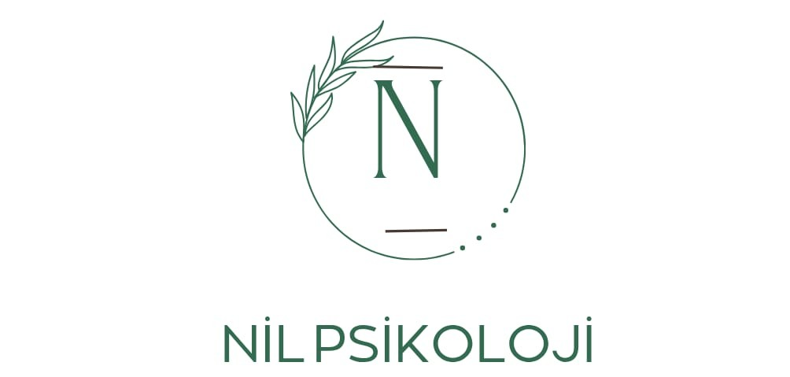
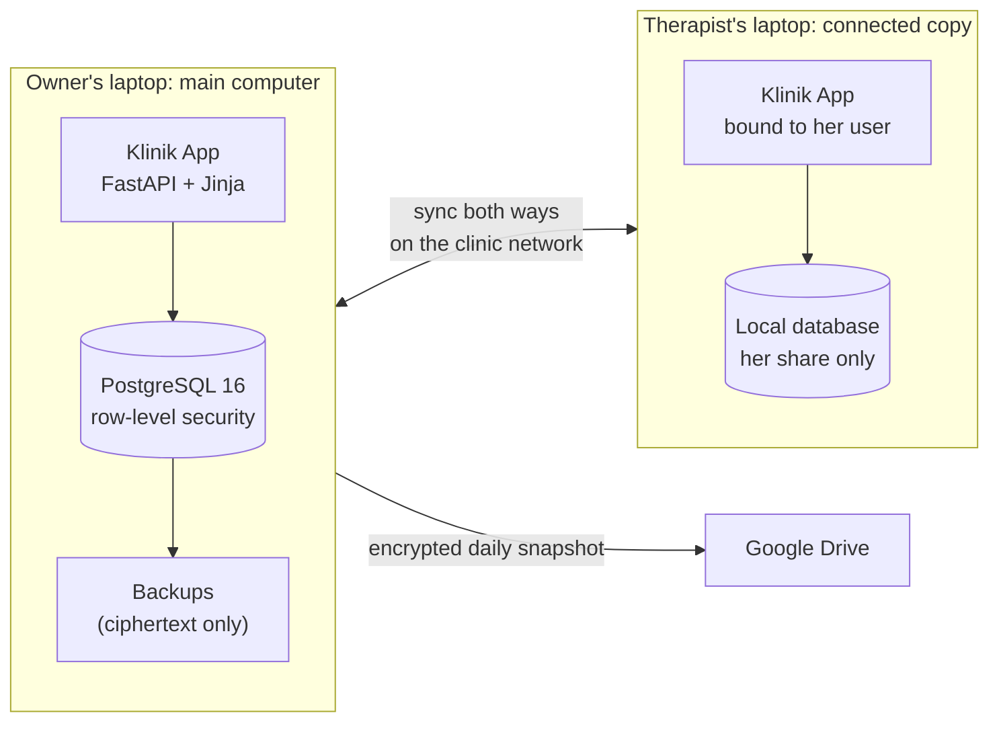

<div align="center">



# Nil Psikoloji: Klinik App

**A private management app for a small psychology clinic: one program, two roles, running on the office laptop and syncing to the therapist's laptop over the clinic network.**


</div>

---

## Contents

- [Overview](#overview)
- [Roles](#roles)
- [Features](#features)
- [Architecture](#architecture)
  - [Two computers, one app](#two-computers-one-app)
  - [Data protection](#data-protection)
- [Project structure](#project-structure)
- [Getting started](#getting-started)
  - [Running it for real](#running-it-for-real)
  - [Development setup](#development-setup)
  - [Creating users](#creating-users)
  - [Building the installer](#building-the-installer)
- [Configuration](#configuration)
- [Migrations](#migrations)
- [Testing and CI](#testing-and-ci)
- [Rules that must not be broken](#rules-that-must-not-be-broken)
- [Documentation](#documentation)
- [History](#history)
- [License](#license)

---

## Overview

Klinik App replaces paper diaries and spreadsheets in a small psychology clinic. It is a single web
application, served locally, with a Turkish interface:

- **The owner's laptop is the main computer.** It holds the database, the encryption keys and the backups.
- **The employee therapist's laptop runs a connected copy** bound to her user. It works on its own,
  without the office being reachable, and syncs both ways when both machines are on the clinic network.
- **Nothing depends on a cloud service** for the schedule, payments or clinical notes.

## Roles

| Role | Sees and does |
|---|---|
| **Yönetici** (owner) | Everything: every therapist's sessions and notes, all income, reports, users and settings |
| **Terapist** | The whole calendar (and booking), their own sessions and notes, their own income. Takes payments (cash, card, transfer) for any appointment |

## Features

| Tab | Highlights |
|---|---|
| **Ana sayfa** | The day's appointments and sessions, plus a month calendar with quick booking |
| **Takvim** | The shared calendar for all therapists and rooms |
| **Terapiler** | Therapy sessions and a therapy-method catalogue |
| **Danışanlar** | Clients, each with a **Klinik notlar** log (encrypted clinical notes timeline) |
| **Gelir-Gider** | Payments by cash, card or transfer, expenses, and net income |
| **Raporlar** | Detailed PDF reports |
| **Günlük özet** | An encrypted daily snapshot, uploaded to Google Drive |
| **Ajandam** | The clinic owner's full-page personal diary |
| **Ayarlar** | Users, rooms, catalogue, backups, laptop pairing and sync conflicts |

Other behaviour worth knowing:

- Cancelled appointments disappear from the calendar.
- Every user signs in with a password and **two-step verification (TOTP)**; a new user gets a
  one-time password and must change it at first login.
- Backups are made automatically, and a restore check can be run to prove they work.

## Architecture

### Two computers, one app



The laptop copy never overwrites the office silently: conflicts wait for the owner, under
**Ayarlar → Çakışmalar**.

### Data protection

- Client identity and clinical text are **Fernet-encrypted in the service layer**. Backups hold ciphertext only.
- The keys never leave the office computer, except inside the **passphrase-protected laptop pairing file**.
- **Row-level security** in PostgreSQL enforces "a therapist sees their own" as a second layer behind the app.
- The database uses separate roles for the app, sync, backup and migrations, each with minimum rights.

## Project structure

```
clinique_program/
├── apps/local/klinik_local/   # the app
│   ├── ajanda/                #   owner's diary
│   ├── anasayfa.py            #   home page
│   ├── ayarlar/               #   settings: rooms, catalogue, backups
│   ├── danisanlar/            #   clients
│   ├── notlar/                #   clinical notes
│   ├── randevular/            #   appointments and calendar
│   ├── terapiler/             #   therapy sessions
│   ├── gelir/                 #   payments, expenses, income
│   ├── raporlar/              #   PDF reports
│   ├── replika/               #   office <-> laptop sync and pairing
│   ├── crypto/                #   Fernet encryption
│   ├── jobs/                  #   backup and restore jobs
│   ├── snapshot.py            #   encrypted daily snapshot
│   └── templates/             #   Jinja templates
├── packages/shared/klinik_shared/   # auth (passwords, TOTP), UI base, calendar, permissions
├── migrations/local/          # Alembic migrations
├── installer/                 # Inno Setup script + PowerShell setup/uninstall
├── infra/                     # Docker Compose dev stack and backup scripts
├── scripts/                   # installer build, demo seed, icons, smoke checks
├── tests/                     # integration and end-to-end tests
├── docs/                      # specs and runbooks
└── assets/                    # logo
```

## Getting started

### Running it for real

Production runs from the Windows installer (`NilPsikoloji-Klinik-Kurulum-<version>.exe`), which sets
up a private PostgreSQL, the app, keys and the admin user. The runbooks cover each step:

| Topic | Runbook |
|---|---|
| Installing the main computer and connected computers | [docs/runbooks/office-installer.md](docs/runbooks/office-installer.md) |
| Windows settings for the office computer | [docs/runbooks/office-laptop-windows.md](docs/runbooks/office-laptop-windows.md) §1 |
| Backups, key custody, monthly restore test | [docs/runbooks/backups.md](docs/runbooks/backups.md) |
| Go-live checklist | [docs/runbooks/go-live.md](docs/runbooks/go-live.md) |

### Development setup

Requirements: Python 3.12, [uv](https://docs.astral.sh/uv/), Docker Desktop (running).

```sh
uv sync                      # install everything into .venv
uv run pytest                # unit + integration tests (integration needs Docker)
uv run ruff check . && uv run ruff format --check . && uv run mypy
```

Run it locally with Docker:

```sh
docker compose --env-file infra/dev.env -f infra/docker-compose.yml up -d --build --wait
```

The app is then at **http://127.0.0.1:8002**.

### Creating users

The installer creates the admin. Afterwards the admin adds users in **Ayarlar → Kullanıcılar** with a
role. From the command line:

```sh
docker compose --env-file infra/dev.env -f infra/docker-compose.yml run --rm -T local-migrate \
  python -m klinik_local.manage create-user --username nil.yilmaz --name "Nil Yılmaz" --role admin
```

Each new user gets a one-time password, must change it at first login, and sets up two-step
verification (TOTP) with an authenticator app.

### Building the installer

```sh
python scripts/build_installer.py     # needs Inno Setup 6
```

The result is written to `dist/`.

## Configuration

Copy `.env.example` to `.env` (git-ignored) and fill it in. Use URL-safe passwords.

| Variable | Purpose |
|---|---|
| `LOCAL_DB_PASSWORD` | Owner role, for migrations only |
| `LOCAL_APP_DB_PASSWORD` | `kasa_app`: the web app, subject to row-level security |
| `LOCAL_SYNC_DB_PASSWORD` | `kasa_sync`: sync tables only |
| `LOCAL_BACKUP_DB_PASSWORD` | `kasa_backup`: `pg_dump` only |
| `LOCAL_FERNET_KEYS` | Encrypts client contact details and clinical text (`primary[,older]`) |
| `LOCAL_AUTH_FERNET_KEY` | Encrypts authentication secrets |

Generate both keys with `python -m klinik_local.manage generate-keys`.
**Keep an offline copy of the keys: losing them loses every note.**

## Migrations

```sh
uv run alembic -n local upgrade head   # needs LOCAL_MIGRATION_DATABASE_URL
```

## Testing and CI

- `uv run pytest` runs unit tests, PostgreSQL integration tests (through testcontainers) and the
  compose-rule checks. End-to-end browser tests (Playwright) are opt-in.
- GitHub Actions (`.github/workflows/ci.yml`) runs `ruff check`, `ruff format --check`, `mypy`, `pytest`
  and a dependency audit on every push to `main` and every pull request.

## Rules that must not be broken

- Client identity and clinical text are Fernet-encrypted in the service layer; the keys never
  leave the office computer except inside the passphrase-protected laptop pairing file.
- Row-level security in PostgreSQL enforces "therapist sees own" as a second layer.
- The laptop copy never overwrites the office silently: conflicts wait for the owner.
- Real `.env` files and keys are never committed. See `.env.example`.

## Documentation

Specs live in [`docs/`](docs/): [`PLAN_MODE_BRIEF.md`](docs/PLAN_MODE_BRIEF.md),
[`TERAPILER_TAB.md`](docs/TERAPILER_TAB.md) and [`IMPLEMENTATION_PLAN.md`](docs/IMPLEMENTATION_PLAN.md).
Runbooks are in [`docs/runbooks/`](docs/runbooks/).

## History

Until 2026-11-18 the schedule and payments lived in a cloud app (Klinik Web) synced with the
office. That was replaced by this single office app; see the git history.

## License

Private project for Nil Psikoloji. No open-source licence is granted; all rights reserved.
